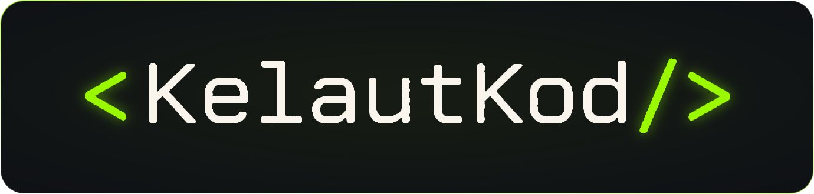

  

  <b>Run Claude Code in several folders at once, side by side.</b> 
  A browser Claude can use, Git history and a small editor, all in one window.

  <a href="https://github.com/danialadzhar/kelautkod-releases/releases/latest"><b>Download for Mac</b></a>
  &nbsp;·&nbsp; Apple silicon (M1 and newer) &nbsp;·&nbsp; Free

---

## What KelautKod does

- **Many sessions, one window.** Open a folder and start Claude Code there. Keep as many folders and sessions as you like. A dot on each one tells you if it needs you or is working, so you do not have to watch them.
- **A browser Claude can use.** Claude can open pages, read them, click and type, in a browser inside KelautKod. You can watch it in a small window, take over any time, and bring in your logins from Chrome.
- **Git history.** See the commits of a project as a graph, with branches and tags. Click a change to compare the old and new file side by side.
- **A small editor.** Browse the folder, open files in tabs with colours and icons, edit and save, and preview images. When Claude changes a file, you see it right away.
- **Your work comes back.** Quit and open KelautKod again: your folders and sessions are there, and Claude picks up the conversation where it stopped.
- **Updates by themselves.** KelautKod finds new versions and installs them when you choose.

## Install

**You need:** a Mac with Apple silicon, [Claude Code](https://code.claude.com/docs/en/overview) and your own Anthropic account. The first-run setup checks both and helps you with them.

1. [Download the latest `.dmg`](https://github.com/danialadzhar/kelautkod-releases/releases/latest) (`KelautKod-<version>-arm64.dmg`).
2. Open it and drag **KelautKod** into **Applications**.
3. Open **KelautKod** from Applications.
4. Follow the short setup. It takes about a minute.

### The first time macOS says it can't verify the app

KelautKod is not yet notarized by Apple, so macOS asks you to confirm once:

1. Open KelautKod. macOS shows a message that it can't verify the app. Click **Done**.
2. Open **System Settings → Privacy & Security**.
3. Scroll to the **Security** section and click **Open Anyway** next to KelautKod.
4. Confirm with your password, then click **Open**.

You only do this once. Updates from inside the app do not ask again.

## What's new

**1.0.30**

- A Subagents panel shows live what each subagent is doing, with a count in the chat bar.
- Subagents can test with the built-in browser.
- The browser tools sit in one grid button, and the mini browser has only Close.
- Small fixes: focus when switching sessions, the changes panel on the right, long folder names, pictures sent once.

**1.0.29**

- Typing stays put while Claude uses the browser in another session.
- .env and other dot files open inside your projects; outside them they stay hidden.
- Run in background in the Beta chat works again.

**1.0.28**

- One chat: the Beta chat replaces the old Chat view, next to the Terminal.
- Menus and panels in the Beta chat open faster, from the session itself.
- Claude's browser can upload files, run scripts on local pages, press keys and read console and network logs.

**1.0.27**

- The Beta chat is the new default: replies show live while Claude writes them, with every chat feature, all in the chat.
- Switching to or from the Beta chat asks first.

**1.0.26**

- View icons sit at the end of the tab row, and the session's tab stays in every view.
- Run an iPhone and an Android phone side by side in Devices, in a drawn iPhone body.
- The usage ring stays, finished replies no longer blink, and chat tables keep their words whole.

**1.0.25**

- Search the chat with Cmd+F, search every session with Cmd+K, and find a file or folder with Cmd+Shift+P.
- PDF, video, sound and other files open in a view of their own.
- No more jump when you come back to a session, equal-size tabs, and no blue ring on inputs.

**1.0.24**

- Camera buttons in the browser take a screenshot of the page or of an area you drag, and attach it to your message to Claude.
- A typing bubble shows while Claude works, and the Model and Effort menus no longer overlap in a narrow chat.

**1.0.23**

- Tables show as tables while Claude is writing, and text selected in a table stays selected.
- Switch models without a confirm card, close the mini browser, and session tabs stay pinned.

**1.0.22**

- A button above the message box jumps back to the newest message when you scroll up.
- Click a quote in a sent message to go back to the reply text it came from, and find pins in the top-left corner.

**1.0.21**

- Claude sessions can talk to each other: mention one with @ and Claude passes your message on.
- Pin text from a reply and jump back to it, drop files anywhere on the chat, and open with Folder Lists beside the chat.

**1.0.20**

- The chat works without the terminal: rewind, export, theme and editor setup open as cards, and new sessions open in chat.
- A new look with card panels and the tabs across the top.

**1.0.19**

- Run long commands in the background from the chat, see their output and stop them, without the terminal.
- Sent pictures show as thumbnails, and a chat | terminal toggle sits in the pane head.

**1.0.18**

- Answer Claude's questions from the chat, and add a note when you allow or deny something.
- See what each tool returned, and mark up pictures before you send them.

**1.0.17**

- The chat can rename, tag and fork conversations, show subagents' work, and cancel queued messages.
- `/config`, `/status`, `/memory`, `/skills`, `/permissions`, `/hooks` and `/plugin` open in the chat, and long conversations can load earlier messages.

**1.0.16**

- A new bar under the chat box for the model, effort, fast mode, permissions and your plan usage.
- Slash commands show their output in the chat, and `/resume`, `/mcp`, `/agents`, `/login` and `/usage` open chat panels.

**1.0.15**

- The chat keeps saying "Claude is working" after you queue a message, and shows for how long.
- A quoted reply shows as a quote, not as raw tags.

**1.0.14**

- Type `@` in the chat for files, folders and your other sessions, and send a message to another session.
- Sessions name themselves from the conversation; names you give stay.
- Queued messages with "Send now", and cleaner live replies.

**1.0.13**

- The chat now runs on top of the terminal: Remote Control, every command and skill work from the chat.
- Live replies, menus as buttons, links and files open beside the chat.
- A cleaner chat: centred, floating message box, tool calls folded.

**1.0.12**

- Chat with Claude: switch any Claude session between the terminal and a chat view.
- Attach images and files, pick the model, effort and permission mode, and use / for commands and skills.
- Reply to part of Claude's answer by selecting it and pressing Reply.

**1.0.11**

- No more "done" status or "Done" notifications. A finished agent goes back to idle.

**1.0.10**

- Run an iOS Simulator inside KelautKod, beside the terminal (needs Xcode).

**1.0.9**

- Run an Android emulator inside KelautKod, beside the terminal (needs Android Studio).
- See uncommitted files beside the terminal as Claude works, with a count on the Git icon.
- The keyboard goes straight to Claude's prompt when you open a session.

**1.0.8**

- Mobile view: see any page as an iPhone, in a phone frame, alone or beside the terminal.
- macOS keeps permissions like Full Disk Access across updates (it asks one last time after this one).
- A cleaner sidebar and pane head, and updates only in a popup.

**1.0.7**

- Updates download in a popup and ask to restart when ready.
- See how much context a session has used, and its Git branch.
- Open any browser tab as a live Mini Browser, video included.

**1.0.6**

- Drag the folder icon onto the terminal to see Folder Lists beside it, and move the terminal to either side.
- Right-click a file, or select lines, to attach them to Claude's prompt.
- A smoother, faster terminal.

**1.0.5**

- Each session has its own tab strip.
- Drag a browser tab onto the terminal to split the view.
- Select element: pick part of a page and send it to Claude's prompt.

**1.0.4**

- Each session has its own browser tabs, and Claude can use them by number.
- Start a new session from the + on a folder in the sidebar.
- Fixed: Claude Code's prompt box no longer disappears when you switch tabs.

**1.0.3**

- Closing a tab keeps the session; delete from the sidebar only.
- Folders in the sidebar fold open and closed, and show 5 sessions at first.
- View icons sit under the tabs, and Git History is side by side.

**1.0.2**

- Open the browser from the + menu, as a tab next to your terminals.
- New Task at the top of the sidebar replaces the Inbox.

**1.0.1**

- Notifications: macOS tells you when an agent needs you or has finished, and the Dock icon shows how many agents need you.
- Search: Cmd+P opens a file by its name, and Cmd+Shift+F searches the text of every file.
- Settings (Cmd+,): the terminal and editor font and size, a dark or light theme, and notifications on or off.
- Calmer status dots, and a launch screen with a progress bar.

**1.0.0**: the first public release.

- Run Claude Code, Codex or a shell in several folders, with live status.
- A built-in browser that Claude can use.
- Git history, and an editor with tabs, saving and side-by-side diffs.
- Rename or delete folders and sessions from the sidebar.
- A launch screen, a first-run setup, and signed automatic updates.

See [all releases](https://github.com/danialadzhar/kelautkod-releases/releases) for the notes of each version.

## Updates

KelautKod checks for a new version by itself. When one is ready, a popup says so: click **Restart to update**. You can also choose **KelautKod → Check for Updates…**. Only updates signed by the author are accepted.

For updates to work, KelautKod needs to be in the **Applications** folder.

## Uninstall

Drag **KelautKod** from Applications to the Trash. To remove its saved data too, delete the folder `~/Library/Application Support/KelautKod`. Your project folders and your Claude conversations are not touched.

## About

> KelautKod is an independent app. It is not made, endorsed or partnered with by Anthropic. It runs Claude Code on your computer. Claude and Claude Code are trademarks of Anthropic, PBC.
>
> KelautKod collects no data. It contacts GitHub only to check for updates. Claude Code sends your prompts to Anthropic under Anthropic's own terms.
>
> KelautKod is free to use. You may not sell, resell or redistribute it. Using it means you agree to the Terms of Use shown the first time you open it.

This repository only holds the built app. The source is private.
